> 本仓库仅含产品介绍、界面截图与集成文档，核心源码不对外公开，需要授权或私有化部署请联系 zsqbg@163.com。

# myWorkflow · 中小企业内部系统一体化底座

> **一套自研审批流引擎，撑起工作流、仓储、资产三大业务插件；PC、Flutter、小程序同源，钉钉与企业微信双向打通。**

请假报销、采购入库、资产领用，往往散落在 Excel、聊天群和若干个互不相通的小系统里：表单改一次要等开发排期，审批到哪一步只能打电话问，仓储和资产各有一套账号与权限。myWorkflow 把这些能力收进同一套底座——**一个账号、一套权限、一个表单引擎、一个流程引擎**，业务人员自己就能搭出审批单据并上线使用。

- 🌐 **在线体验**：http://xayuhong888.gnway.vip:40060/admin
- 👤 **演示账号**：`admin` / `123456`

**开箱即用**：35 种表单字段 · 拖拽式流程编排 · 会签/或签 · 三大业务插件 · 多端覆盖 · 钉钉/企微对接

---

## 💡 为什么是一体化底座

| 常见困境 | myWorkflow 的做法 |
|---|---|
| 表单、流程改一次就要开发排期 | 业务人员拖拽设计表单与流程，配置完成即可使用 |
| 审批、仓储、资产各是一套系统 | 共用同一套账号、权限、表单与流程引擎，数据互通 |
| 审批只能回办公室处理 | PC + Flutter 移动端 + 小程序同源，外勤也能即时审批 |
| 员工日常在钉钉/企微里办公 | 审批双向同步：本地单据推送到平台待办，平台结果回写本地 |
| 流程一改，历史单据就乱 | 流程版本快照，在途实例始终按发起时的版本执行 |

---

## 🧩 核心一：自研审批流引擎

> 表单、流程图、审批状态机全部自研，不依赖第三方流程中间件。因此可以深度贴合国内企业的审批习惯：会签、或签、加签、转办、驳回、抄送、条件分支、版本快照，一个都不少。

### 自定义表单设计器

> 表单是业务数据的入口。从字段配置到渲染、校验、存储全链路可配置，不写代码就能生成业务单据。

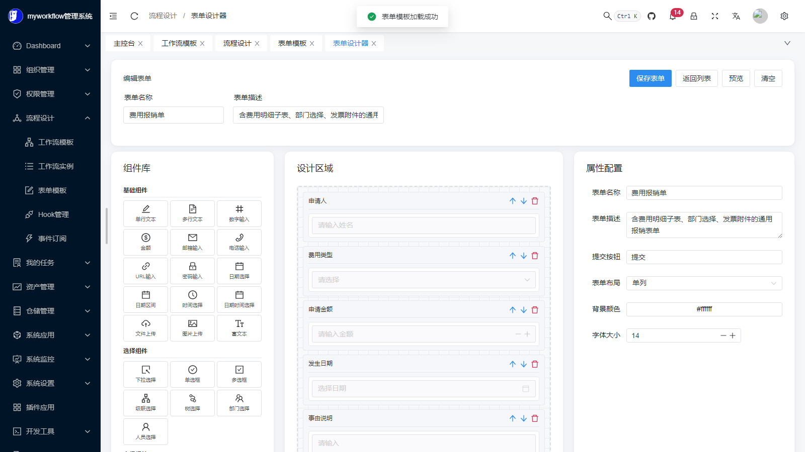

| 分类 | 组件 |
|---|---|
| 基础组件 | 单行文本、多行文本、数字、金额、邮箱、手机、URL、密码、日期、日期区间、时间、日期时间、上传、图片、富文本 |
| 选择组件 | 下拉选择、单选框、多选框、级联、树形选择、**部门选择**、**人员选择** |
| 高级组件 | 开关、评分、滑块、流水号、地图 |
| 布局组件 | 分隔线、分组说明 |
| 容器组件 | **明细子表**（可配置列/宽度/必填/参与合计/最少最多行数） |
| 业务组件 | **关联表单**（选择来源实例并按映射自动回填） |

- 业务人员拖拽即可完成设计并上线，不必依赖开发排期
- 申请、审批、归档各环节看到的是同一张表单，表现一致、口径统一
- 金额与明细合计自动校验，必填项（含子表列）强制检查，数据从入口就是准确的
- 表单一旦被流程引用即自动锁定，历史单据结构不会被后续修改破坏

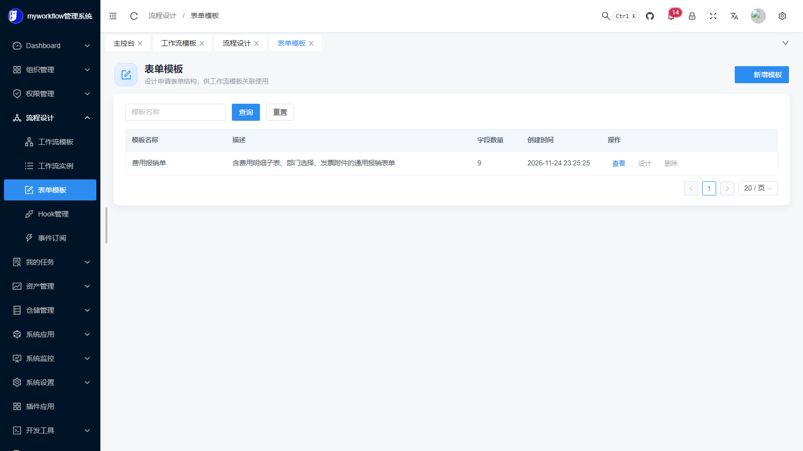

### 可视化流程设计器

> 不是写死的顺序审批，而是真正的图编排：拖拽节点、连线、配置条件，所见即所得。

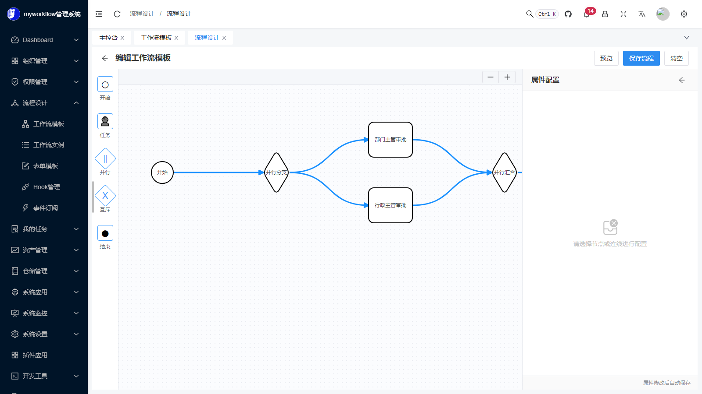

| 节点 | 说明 |
|---|---|
| 开始 / 结束 | 流程入口与出口，强制唯一 |
| 审批任务 | 配置审批人（用户 / 部门 / 角色）、**会签 AND / 或签 OR**、抄送人、通知内容 |
| 并行网关 | 多条分支同时推进，全部完成后汇合 |
| 互斥网关 | 按连线条件 + 优先级选择唯一分支，支持字段/操作符/值/且或逻辑 |
| 条件出边 | 可视化配置分支条件，修改后条件表达式无损回显 |

- 拖拽节点、连线并配置条件即可完成编排，并行、互斥分支一目了然
- 保存即发布**流程版本快照**，在途单据不受模板后续调整影响，需要时可一键回滚
- 审批人、会签/或签、抄送、分支条件都在属性面板中配置，业务调整不用改代码

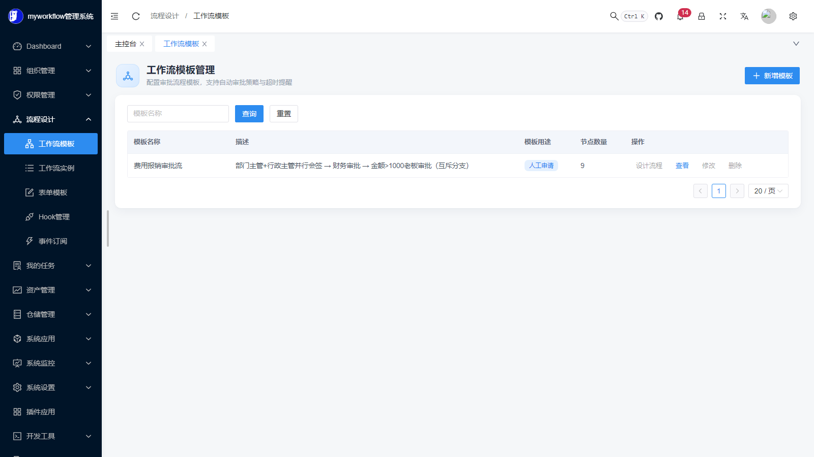

### 审批执行引擎

> 审批不是「点一下通过」，而是要考虑并发、审计、异常流转与安全边界的完整状态机。

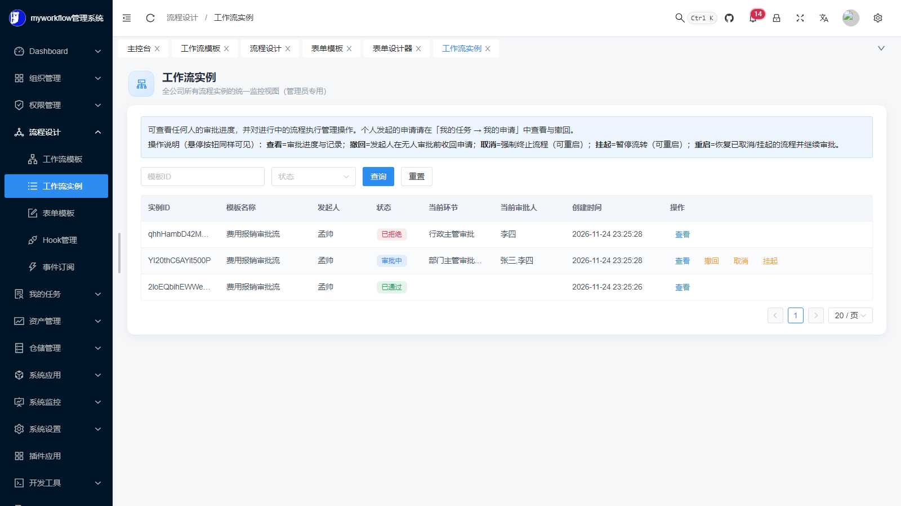

| 能力 | 实现 |
|---|---|
| 审批人指定 | 用户 / 部门（展开启用成员）/ 角色（展开成员）/ 抄送人 |
| 审批策略 | 或签 OR（任一人通过）、会签 AND（全部通过，任一拒绝即拒绝） |
| 流转操作 | 通过、驳回（强制填写原因）、转办、加签、撤回、取消、挂起/恢复、重启 |
| 抄送 | 知会不参与审批，独立的「抄送我的」列表 + 已读标记 |
| 条件分支 | 条件表达式（`== != > < >= <= contains` 等），组间 OR / 组内 AND-OR |
| 并发安全 | 任务级与节点级 CAS + 事务，杜绝重复审批与并发串改 |
| 身份校验 | 非本人审批直接拒绝；管理员代审留痕，全程可审计 |
| 审计日志 | 审批日志、事件订阅（通过/拒绝/抄送等）、企微与钉钉回调 |

**实例详情**一屏展示申请内容（含子表明细）、审批意见与完整流程时间线（已通过 / 已拒绝 / 审核中 / 未执行）：

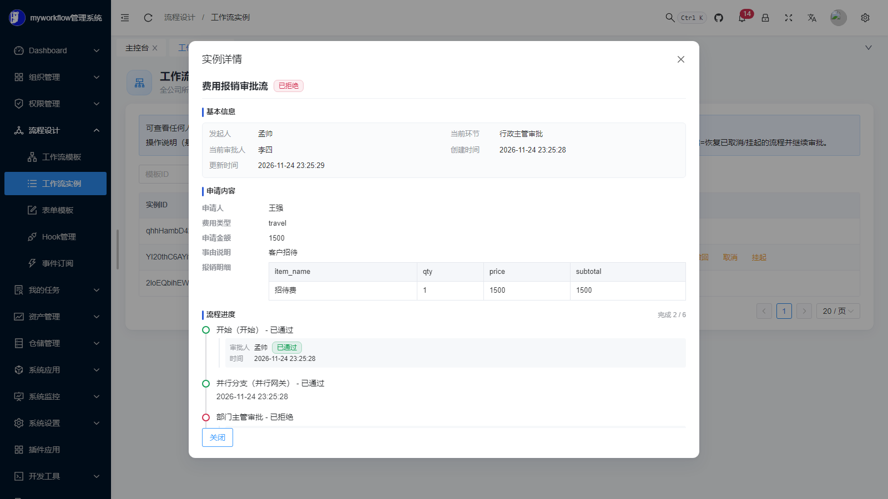

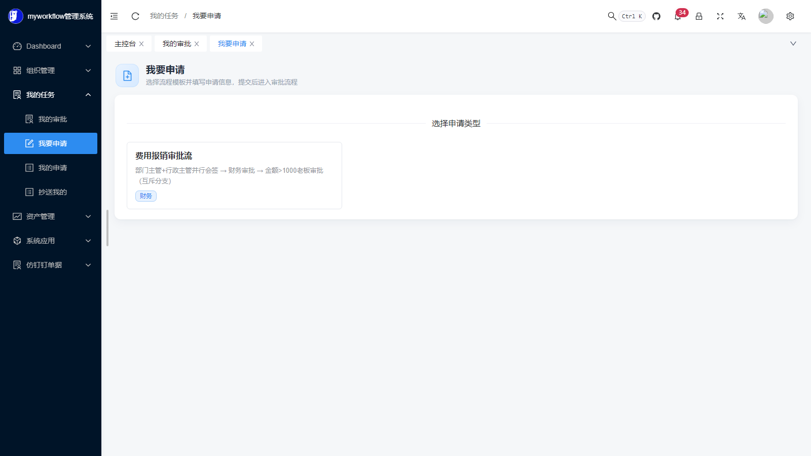

> 内置**仿钉钉单据中心**：按请假、出差、费用报销等类型集中发起与查看单据，审批人几乎零学习成本。

---

## 📦 核心二：三大业务插件

三套插件共用同一套账号、权限、表单与流程引擎，可按需启用，也可以只保留其中一套。

### 工作流

表单模板 → 流程设计 → 发起申请 → 我的审批 → 抄送我的 → 实例详情，覆盖企业行政审批的完整闭环；支持条件分支、并行网关、版本回滚与全局审计。

### WMS 智能仓储

供应商 / 客户 / 商品（Excel 导入导出、预警阈值）→ 仓库三级结构 → 入库单 / 出库单（**草稿→待审核→已审核→已执行**状态机 + A4 打印）→ 实时库存 / 冻结解冻 / 调整 / 移库 / 盘点 → 统计看板与趋势分析 → 库存预警（定时扫描 + 铃铛推送 + 菜单角标）。

### 资产管理

资产台账、采购/领用/归还/移交/报废单据、报修与维修派工、保养/巡检计划、二维码、打印中心、可视化大屏；移动端共用同一套后端接口。

### AI 智能助手（内置）

用自然语言查库存、查流水、查单据、起草入库单。`supervisor + 4 专家 + 确认闸门` 图编排，真 Function Calling 提取参数，流式逐字返回；涉及写库的操作只生成草稿，必须人工确认后才落地。

---

## 📱 核心三：PC / Flutter / 小程序多端

| 端 | 覆盖 |
|---|---|
| PC 管理后台 | 表单与流程设计、审批处理、仓储与资产全量操作、后台配置 |
| Flutter App | 移动审批、扫码、查库存、资产盘点等高频现场场景 |
| uni-app 小程序 | 免安装使用，适合一线员工与外勤人员 |

多端共用同一套后端接口与权限体系，PC 上配置的流程和表单在移动端即时可用，移动端提交的单据也会进入同一条审批流水线。

### 移动端界面

移动端不是 PC 的缩小版：一线员工在手机上即可完成「首页待办 → 填写请假单 → 我的审批 → 审批详情」的完整闭环，PC 上配置的流程与表单在手机端即时可用。

<table>
  <tr>
    <td align="center">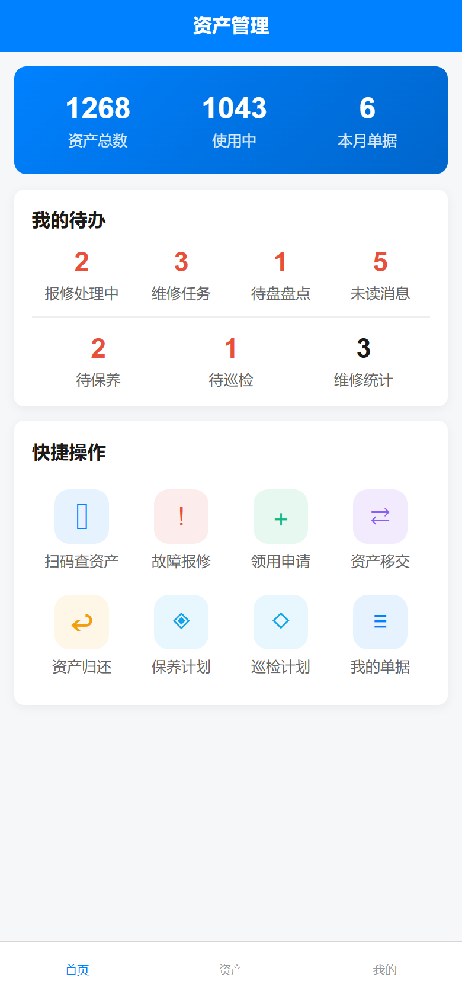 首页 · 我的待办与快捷入口</td>
    <td align="center">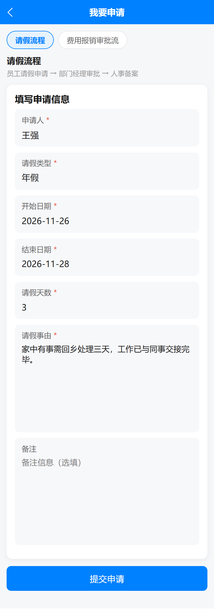 发起申请 · 动态表单渲染请假单</td>
    <td align="center">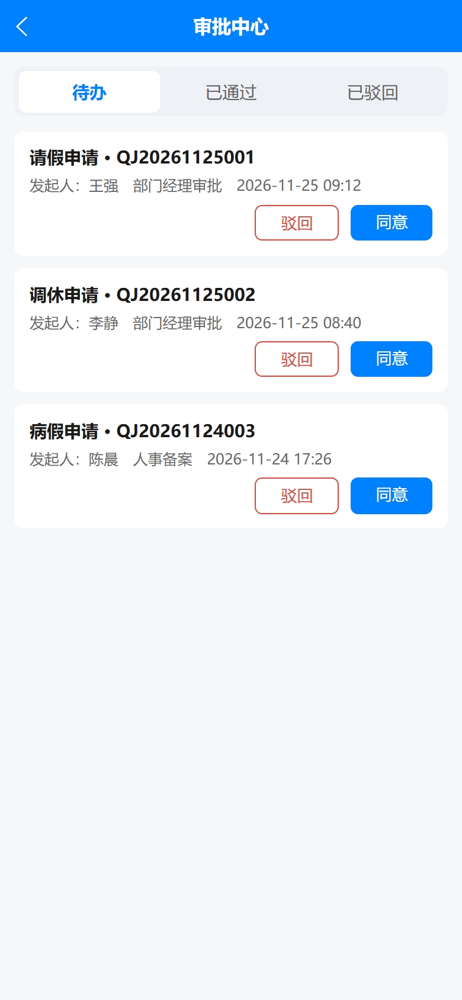 我的审批 · 待办 / 已通过 / 已驳回</td>
  </tr>
  <tr>
    <td align="center">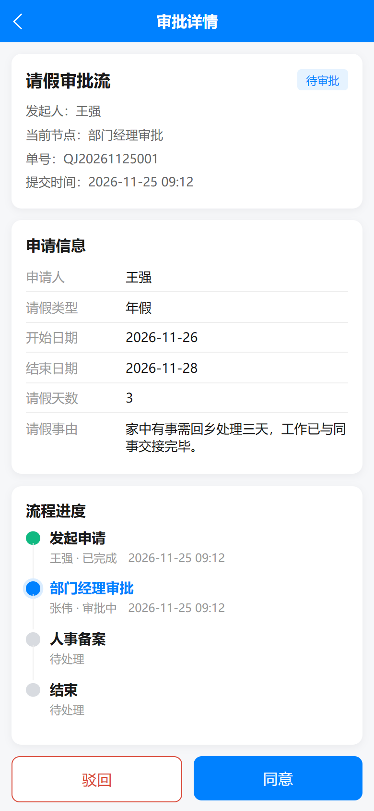 审批详情 · 申请内容 + 流程进度 + 同意/驳回</td>
    <td align="center">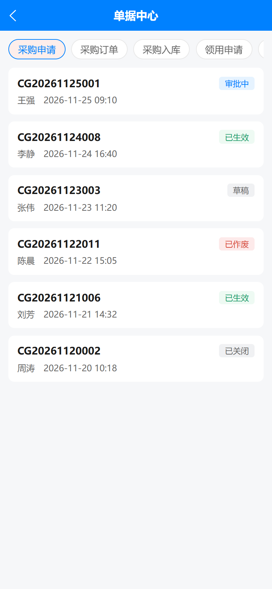 审批单据 · 采购 / 领用 / 归还 / 报废</td>
    <td></td>
  </tr>
</table>

---

## 🔗 核心四：钉钉 / 企业微信对接

| 方向 | 能力 |
|---|---|
| 本地 → 平台 | 发起单据时自动在钉钉/企微创建审批实例，待办出现在员工熟悉的办公软件里，并可按需推送消息 |
| 平台 → 本地 | 平台审批结果回调：验签 + 幂等 + 账号映射后回写本地，且仍走本地审批校验，不绕过任何护栏 |
| 容错 | 平台不可用时不影响本地流程，同步失败登记并可补偿重试，不把系统可用性绑在外部平台上 |
| 表单映射 | 本地表单字段可映射为平台审批表单控件，保留业务字段语义 |

---

## 🏢 适用场景

| 场景 | 典型应用 |
|---|---|
| 行政与人事 | 请假、加班、报销、用印、合同会签等日常审批 |
| 采购与供应链 | 采购申请、比价审批、入库、出库、到货与库存预警 |
| 仓储物流 | 多仓库三级结构、实时库存、调拨移库、盘点、单据打印 |
| 资产与设备 | 资产台账、领用归还、移交报废、报修派工、保养巡检 |
| 多端移动办公 | 移动端审批、查库存、扫码查资产，外勤也能即时处理 |
| 智能助理 | 用自然语言查询库存与单据、起草业务单据草稿 |

---

## 🛡️ 安全与可靠

- **权限可控**：菜单 / 按钮级权限体系，越权写操作直接拦截，非法参数预校验不落库
- **身份与审计**：非本人审批自动拒绝，代审留痕，审批日志、抄送与已读状态全程可追溯
- **并发安全**：同一审批任务不会被重复通过或并发改写，流程实例绑定版本快照
- **数据可信**：出库条件扣减防超卖，库存流水前后快照永不回改，单号唯一不重复
- **AI 可控**：AI 只生成草稿，必须由人工二次确认后才写入业务系统
- **质量保障**：核心链路的自动化用例均在真实环境验证（非 Mock）

| 验证范围 | 结果 |
|---|---|
| 工作流全链路（表单 / 流程设计器 + 网关 + 审批 + 护栏 + 版本） | **26/26** |
| WMS 全量业务接口回归 | **171/171** |
| 基础回归 / 移动端接口 | **57/57 · 53/53** |
| 库存预警 / Excel / 打印 / AI 问答 | **31/31 · 20/20 · 12/12 · 7/7** |
| AI 流式问答端到端契约 | **4/4** |

---

## 🌐 在线演示

| 项 | 值 |
|---|---|
| 地址 | http://xayuhong888.gnway.vip:40060/admin |
| 账号 | `admin` |
| 密码 | `123456` |

> 演示环境数据仅供体验，请勿录入真实敏感信息。

---

## 📮 联系方式

- 邮箱：zsqbg@163.com

欢迎垂询产品能力、预约演示或沟通定制需求。
